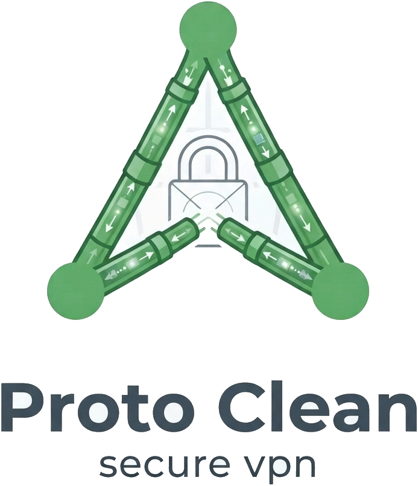

# Proton Clean

<p align="center">
  
</p>

A clean-room client for **ProtonVPN** — **Linux, Windows, macOS and
Android** — built around your own Proton account:

- **Backend-browser login with saved credentials** — Proton Clean drives a
  bundled Chromium (Playwright) to log into `account.protonvpn.com`.
  Save your credentials once (**Log in… → Remember me**) and every launch
  — and every session expiry mid-connect — logs in automatically.
  Credentials live in your system keyring (or a chmod-600 file), together
  with an optional TOTP secret that answers 2FA prompts by itself.
- **CAPTCHA relayed to you** — when Proton challenges the automatic login
  with a CAPTCHA / human verification, a **browser window opens on exactly
  that step**, and Proton Clean tells you what's going on: a banner in the
  main window, a status-bar message and a desktop notification. Finish the
  verification in the window and login continues by itself — no restart,
  no re-typing (credentials are pre-filled in the window). You can also
  start a login *in the browser* on purpose (Login dialog → “Log in in
  browser…”).
- **Server list with live loads — free servers only** — after login it
  scrapes the Downloads page and shows every **free** server with its
  current load and features. Paid (Plus/Secure Core) servers are excluded
  from the list and from selection, exactly like the page's own
  "Free server configs" category.
- **Fastest server, one toggle** — the toggle at the top auto-connects to
  the fastest available free server using Proton's own live server score.
- **Protocol choice: WireGuard or OpenVPN** — Settings → Protocol picks
  which config Proton Clean downloads from the Proton page. **WireGuard**
  (default) shows the NAT-PMP (Port Forwarding) and VPN Accelerator
  toggles, both on by default. **OpenVPN** adds a TCP/UDP transport
  choice, and the network driver is selectable in Advanced: **TUN**
  (routes traffic between networks — faster, more stable) or **TAP**
  (bridges network traffic — slower, needed for some legacy setups).
  Both protocols are cached, tunneled and kill-switched identically on
  Linux/macOS; Windows/Android tunnel WireGuard only (see Known limits).
- **Advanced settings (Proton-style)** — Alternative routing (mirror API
  hosts when the direct ones are blocked), Allow LAN connections, Custom
  DNS servers (your resolvers instead of Proton's, via the embedded DNS
  blocker), NAT type (Moderate NAT), and IPv6 controls: **IPv6 support**
  routes `::/0` through the tunnel for better v6-site compatibility,
  **IPv6 leak protection** (on by default) blocks any IPv6 that would
  bypass the tunnel — independently of the kill switch.
- **WireGuard, seamlessly — with local config caching** — configs are
  downloaded once and cached per server (per protocol!); later connects
  reuse the saved config without touching the browser. A cached config is
  re-downloaded **only when it fails** (tunnel won't come up or the handshake
  never completes, e.g. the certificate was revoked). Existing configs on
  your account page — WireGuard and OpenVPN sections alike — are harvested
  automatically to warm the cache.
- **Local NetShield (ad/malware blocking)** — an in-process DNS server
  filters every DNS query against locally-maintained blocklists. The
  **Blocklists ▾ menu** (and the full manager dialog) lets you add, remove,
  enable/disable and update lists — StevenBlack by default, with HaGeZi,
  OISD, 1Hosts and Peter Lowe as one-click presets. No Proton DNS feature
  needed — works on the free plan.
- **Split tunneling** — excluded **IP ranges** work on every platform
  (they are carved out of the tunnel's AllowedIPs); excluded **apps** run
  outside the tunnel via cgroup-v2 fwmark routing on Linux and via
  Android's native VpnService app exclusion.
- **Kill switch** — Linux: nftables/iptables; Windows: per-physical-adapter
  firewall blocks with the endpoint carved out; macOS: pf; Android:
  full-route tunnel (+ system lockdown detection). Traffic outside the
  tunnel is blocked while connected on every platform. The endpoint rule
  follows the protocol's transport (UDP for WireGuard, TCP *or* UDP for
  OpenVPN).
- **Port forwarding** — ticks the NAT-PMP option on the download page and
  keeps the mapping alive (gateway `10.2.0.1`, ~60 s lease, refreshed at
  45 s) once connected. *(paid plans only — Proton's restriction)*
- **VPN Accelerator** — toggled on the download page in the backend
  browser exactly as you set it. *(the only VPN option available on the
  free plan)*
- **Dark, light and system themes** — the **Theme ▾** menu in the bottom
  bar (or Settings → Appearance) switches between **Dark mode** (the
  original look), **Light mode** (bright surfaces, same violet accent)
  and **System theme**, which follows the desktop color scheme and
  live-switches when the system flips between light and dark. The choice
  is remembered across launches (legacy `prefer_dark_theme` settings
  migrate automatically).

Per-OS plumbing, packaging and limitations: **[docs/PLATFORMS.md](docs/PLATFORMS.md)**
(Android app: **[android/README.md](android/README.md)**).

Proton Clean is an independent client. It is not affiliated with or endorsed
by Proton AG. Automating the account web app is a convenience for *your
own account*; if Proton changes their UI, the scrapers may need updating
(they log debug screenshots to `~/.cache/proton-clean/screenshots` when a
step fails). Check Proton's terms of service before relying on it.

---

## Requirements (desktop)

- Linux: `wg`, `wg-quick` (wireguard-tools), `ip`, `iptables`, cgroup v2
  (only for app-based split tunneling) — any modern distro works.
  Optional: `openvpn` for the OpenVPN protocol (`sudo apt install openvpn`).
- macOS: `brew install wireguard-tools` (`pfctl`/`networksetup` are built
  in). Optional: `brew install openvpn` for the OpenVPN protocol.
- Windows: [WireGuard for Windows](https://download.wireguard.com/windows/)
  (`wireguard.exe` + `wg.exe`) — WireGuard protocol only
- Python ≥ 3.10
- A Proton account (free plan works: free servers, VPN Accelerator and
  local ad-blocking; port forwarding / NetShield / Moderate NAT need paid)

## Install

**Linux**

```bash
cd proton-clean
bash scripts/install.sh
```

**macOS**

```bash
brew install wireguard-tools
bash scripts/install_macos.sh
```

**Windows** (from source)

```powershell
pip install -r requirements.txt
python -m playwright install chromium
python -m proton_clean
```

**Android** — build the APK from [`android/`](android/) with
`./gradlew assembleDebug` (details in the Android README).

The Linux/macOS installers:

1. installs Python dependencies (+ Chromium for Playwright, ~170 MB, once)
2. installs the privileged helper to `/usr/local/bin/proton-clean-helper`
3. adds a **sudoers entry limited to that single binary** — no blanket
   sudo: `youruser ALL=(root) NOPASSWD: /usr/local/bin/proton-clean-helper`

Uninstall with `bash scripts/uninstall.sh`.

On **Windows** there is no sudo: when the app is elevated the privileged
verbs run in-process; otherwise each connect shows **one UAC prompt**
(the whole sequence is a single elevated batch).

## Run

```bash
python3 -m proton_clean            # GUI
python3 -m proton_clean --cli      # headless environment check
python3 -m proton_clean -v         # debug logging
```

First launch: the **login dialog** opens by itself. Enter your Proton
username and password, keep **Remember me** checked (default) and Proton Clean
auto-logs-in from then on — at launch and whenever the session expires.
Optionally store your **TOTP secret** so two-factor prompts are answered
automatically; if Proton shows a CAPTCHA, finish it in the window that
opens and login continues. Prefer typing in a real browser? Use **Log in
in browser…**.

### Daily use

- The **Fastest server** toggle at the top connects to the best free
  server by Proton's live score; click any row to pick a server instead.
  Only free servers are listed — paid servers are excluded everywhere.
- **Blocklists ▾** (bottom bar) manages the ad-blocking lists: update all,
  enable/disable each list, add (with presets), remove, and a full
  manager dialog with domain counts and update times. Changes hot-swap
  into the running DNS blocker — no reconnect needed.
- **Theme ▾** (bottom bar) switches Dark / Light / System instantly —
  no restart; System keeps following the desktop scheme.
- The tray icon gives you connect/disconnect/quit; closing the window
  keeps Proton Clean in the tray.
- While connected you get live stats (handshake age, up/down bytes,
  endpoint) and, on paid plans, the forwarded external port.
- Configs are cached in `~/.cache/proton-clean/configs/`; connect twice to
  the same server and the second attempt skips the download entirely.

## How each feature works

| Feature | Mechanism |
| --- | --- |
| Login | Playwright Chromium; two-step form (`#username` → Continue → `#password`); storage-state cached in `~/.config/proton-clean/browser-state.json`; login dialog with **Remember me** (keyring / chmod-600 file + optional TOTP secret); CAPTCHA/2FA → visible window for that step only, relayed to you via banner + notification |
| Server list (free only) | the logged-in page's own logicals XHR (Load/Score/Tier/Features), filtered to Tier 0 → fallback: same-origin fetch by the page (with **alternative routing**: mirror hosts `api.protonvpn.com` / `vpn-api.proton.me`) → fallback: scrape of the rendered "Free server configs" country tables (`#section-wireguard-configuration`, 121 free servers verified against the real page) |
| Fastest | min `Score` among online free-tier logicals (Proton's own metric); local load-based heuristic if Score is missing; saturated (>90%) servers deprioritised |
| Protocol | Settings → Protocol: WireGuard (default) or OpenVPN. **WireGuard**: NAT-PMP (Port Forwarding) + VPN Accelerator toggles (both on by default) — set on the page via `#feature-PortForwarding` / `#feature-SplitTCP`. **OpenVPN**: the page section `#section-openvpn-configuration` with layered selector candidates, TCP or UDP transport radios, same Linux platform / free-category / exact-row Create flow; the TUN/TAP driver is a *local* choice applied at `ovpn-up` |
| Config | Platform=GNU/Linux radio, option toggles by id, "Free server configs" category, exact-match server row → Create → capture (XHR body, the new certificate's textarea, or the Download file); WireGuard configs look like `[Interface]`+`PrivateKey`, OpenVPN captures require a `remote` line |
| Config cache | per-server cache in `~/.cache/proton-clean/configs/` keyed by server + protocol + transport + option fingerprint (`wg-acc1-nat0`, `ovpn-tcp-acc1-nat1`, …) — a lookup never crosses protocols; connect flow: cached config → tunnel up → **handshake verified**; on failure the entry is invalidated and the config re-downloaded once; existing certificates (both sections) are harvested from the page to warm the cache |
| Tunnel (WireGuard) | captured config validated (hooks like `PostUp` are refused) → staged (`/etc/wireguard/proton_clean.conf`, 0600) → `wg-quick up` (Linux/macOS) or `wireguard.exe /installtunnelservice` (Windows) — all through the same verb whitelist |
| Tunnel (OpenVPN) | `.ovpn` validated (must have `remote`; `up`/`down`/`script-security` shell hooks refused — same stance as WireGuard's PostUp) → staged to `/etc/openvpn/proton-clean/proton-clean.ovpn` (0600, dir 0700) → helper `ovpn-up tun|tap` runs `openvpn --config … --dev proton_clean0 --dev-type <driver> --daemon --writepid` → status via pidfile + interface counters (reports a live "handshake" to the app's liveness check); `ovpn-down` SIGTERMs the pid |
| Advanced: custom DNS | the embedded DNS blocker answers system-wide and forwards to your servers (ordered fallback) — works identically over WireGuard and OpenVPN; when ad blocking is off it runs with an empty filter |
| Advanced: IPv6 | **support on**: WireGuard config keeps `::/0` (OpenVPN gets `route-ipv6 ::/0` + `tun-ipv6` for TUN); **support off**: IPv6 is stripped from the config so it never enters the tunnel. **Leak protection on** (default): `v6-on` verb adds an ip6tables chain (macOS: `proton_clean.v6` pf anchor; Windows: `ProtonCleanV6` firewall group) blocking IPv6 except loopback, both tunnel interfaces and the split-tunnel mark — independent of the kill switch, armed before tunnel-up |
| Ad blocking | DNS server (dnslib) on loopback — port 5353 on Linux/macOS, port 53 on Windows; port-53 traffic is redirected there (Linux: iptables REDIRECT; macOS: root relay + `networksetup`; Windows: the config's DNS is rewritten to `127.0.0.1`); upstream = DoH to Proton's `doh.protonvpn.ch` through the tunnel, plain-UDP `10.2.0.1` (or your custom DNS servers) as fallback; blocked names → NXDOMAIN or `0.0.0.0` |
| Blocklist management | per-list cache files (`~/.cache/proton-clean/blocklists/<slug>.txt` + metadata); add / remove / enable / update-one / update-all; enabled lists merged into `merged.json` → hot-swapped into the live DNS filter (answer cache flushed) |
| Split tunnel | **IP ranges (all desktop OSes):** the CIDRs are subtracted from the tunnel's AllowedIPs, so they keep the original route. **Apps (Linux):** excluded apps live in the root-level cgroup `proton_clean_split`; an iptables mangle rule fwmarks their packets (mark 42); `ip rule fwmark 42 → table 51821` routes them via your original gateway. **Apps (Android):** native `excludedApplications` |
| Kill switch | Linux: iptables/ip6tables OUTPUT chain (allow lo + both tunnel interfaces + the endpoint over **its own transport, udp or tcp** (+LAN) + fwmark 42, drop the rest); Windows: per-physical-adapter block rules with the endpoint (+LAN) carved out by CIDR subtraction (group `ProtonCleanKS`); macOS: pf anchor with the same allow list, auto-added and reverted in `/etc/pf.conf`; Android: full-route tunnel + lockdown detection |
| Port forwarding | NAT-PMP MAP-UDP (RFC 6886) to `10.2.0.1:5351`, lease kept alive at ~75 %; on free plans Proton answers "not authorized" and the UI reports it |
| 2FA | stored TOTP secret → RFC 6238 code generated locally (no network); otherwise a dialog asks for the code |
| Theme | `ui/theme.py` ships two full stylesheets (`DARK_QSS`, `LIGHT_QSS`) + matching `QPalette`s; `apply_theme(app, mode)` resolves `system` via Qt's `colorScheme` hint (Qt ≥ 6.5), the GNOME `color-scheme` gsettings key, or palette lightness; in system mode `colorSchemeChanged` re-applies live. Persisted as `settings.theme`; legacy `prefer_dark_theme: false` migrates to `light`. Runtime painters ask `theme.is_dark()` (load-bar tracks, icons) |
| Login events | the backend browser relays `captcha` / `interactive_open` / `interactive_done` / `totp_needed` / `bad_credentials` / `credentials_needed` through the controller → bridge → banner + tray notification; wrong or missing credentials re-open the login dialog pre-filled |

## Security notes

- Credentials: system keyring preferred; the fallback file is `~/.config/proton-clean/credentials.json`, `chmod 600`, and never logged. (Windows: DPAPI-backed keyring / protected file. Android: EncryptedSharedPreferences.)
- The helper runs as root but only accepts a fixed verb list with
  strict argument validation (interfaces, IPs, ports, uid/gids are
  regex/IP-validated; config files must parse as WireGuard configs with
  no shell hooks). Review `helper/proton-clean-helper` (Linux/macOS) and
  `proton_clean/helper_win.py` (Windows) yourself.
- The kill switch is installed *before* the tunnel comes up, so there is
  no leak window during connect; it is removed on disconnect/quit.
- WireGuard configs are root-readable only (Linux/macOS:
  `/etc/wireguard/proton_clean.conf`, 0600). OpenVPN configs likewise
  (`/etc/openvpn/proton-clean/proton-clean.ovpn`, 0600, dir 0700) — and the
  helper refuses `.ovpn` files carrying `up`/`down`/`script-security`
  shell hooks, exactly as it refuses `PreUp`/`PostUp` in wg-quick files.

## Layout

```
proton_clean/
├── proton_clean/
│   ├── account/       # backend browser: login + downloads-page scraping
│   ├── platforms/     # per-OS backends: factory, capabilities, Linux
│   │                  # (sudo/iptables/cgroup), Windows (UAC/firewall),
│   │                  # macOS (sudo/pf/networksetup)
│   ├── servers/       # logical-server model, store, fastest selection
│   ├── vpn/           # wg-quick + OpenVPN config handling, config cache,
│   │                  # tunnel, kill switch, split tunnel, NAT-PMP, monitor,
│   │                  # helper facade
│   ├── netshield/     # blocklist manager + embedded DNS server
│   ├── ui/            # PySide6: main window, blocklists manager, settings,
│   │                  # tray, theme, icons
│   ├── controller.py  # state machine orchestrating everything
│   ├── helper_win.py  # Windows privileged verbs (UAC batch executor)
│   ├── credentials.py # keyring/file storage
│   ├── settings.py    # settings.json (per-OS paths)
│   └── totp.py        # RFC 6238 codes for automatic 2FA
├── helper/proton-clean-helper  # privileged verb-whitelisted helper (root,
│                           # Linux + macOS implementations)
├── android/           # Android app: Kotlin + Compose + GoBackend +
│                      # DNS-filter VpnService (see android/README.md)
├── packaging/         # PyInstaller specs + build scripts (win/mac/linux)
├── scripts/           # install.sh, install_macos.sh, uninstall.sh,
│                      # dev_smoke.py, ui_screenshot.py, verify_real_dom.py
├── tests/             # pytest suite (132 tests incl. live DNS + flow tests)
└── docs/ARCHITECTURE.md, docs/PLATFORMS.md
```

## Development

```bash
pip install -r requirements.txt pytest
python -m pytest tests/ -q                    # unit + live DNS + flow tests
python scripts/dev_smoke.py login-page        # selector check vs. live Proton
python scripts/dev_smoke.py blocklist         # blocklist download check
python scripts/verify_real_dom.py             # selectors vs. the real DOM dump
QT_QPA_PLATFORM=offscreen python scripts/ui_screenshot.py  # render the UI
```

`dev_smoke.py login-page` was verified against the live
`account.protonvpn.com` login page (Nov 2026): two-step
username → Continue → password flow confirmed.

`verify_real_dom.py` replays every WireGuard-section selector against the
real logged-in page DOM: the 121 free servers of the "Free server configs"
tables, the `#certificate-device-name` input, the `#feature-*` toggles,
the exact-match server rows and the existing-certificate textareas all
verified against a real dump (Nov 2026).

## Known limits

- Web-UI automation can break when Proton ships a redesign; debug
  screenshots land in `~/.cache/proton-clean/screenshots`. The OpenVPN
  section's ids are less stable than the WireGuard ones — Proton Clean uses
  layered selector candidates there, and a failure logs a screenshot.
- Free plan: no NAT-PMP port forwarding, no Proton-side NetShield and no
  Moderate NAT — Proton enforces this server-side. The local blocklist
  ad-blocker is the free-plan answer to NetShield.
- **Windows**: OpenVPN tunneling is not available (the bundled tunnel
  driver is WireGuard only) — selecting OpenVPN there shows a clear error
  at connect; keep WireGuard. **Android**: same — the tunnel runs
  WireGuard (GoBackend), so OpenVPN is shown disabled in the app's
  settings.
- Windows/macOS: per-**app** split tunneling needs kernel support that is
  not available to user space — use IP-range exclusions there (the
  settings UI explains this). Linux and Android support apps fully.
- Android: local DNS filtering runs as the standalone Ad-blocker mode
  (Android allows one VpnService per app) — see docs/PLATFORMS.md.
- Split-tunneled apps share the system DNS path; their DNS may still be
  answered through the tunnel (by design of the system-wide redirect).
- IPv4 + IPv6 both routed/filtered; LAN access off by default while the
  kill switch is on. On macOS the IPv6-leak-protection pf anchor blocks
  all outbound IPv6 except loopback and the OpenVPN interface — for
  tunneled IPv6 on macOS combine IPv6 support with the kill switch.

## Download & install

Ready-made installers are on the
[Releases page](https://github.com/maniesh-NR/Proton-Clean/releases)
(built by the `Release` workflow on every tag):

| Platform | File | Install |
|---|---|---|
| Linux Mint / Ubuntu / Debian | `proton-clean_0.1.0-1_amd64.deb` | `sudo apt install ./proton-clean_0.1.0-1_amd64.deb` |
| Linux (portable) | `Proton-Clean-0.1.0-linux-x86_64.tar.gz` | untar, run `proton-clean/proton-clean` |
| Windows 10 / 11 | `Proton-Clean-0.1.0-win64.zip` | unzip, run `ProtonClean.exe` (+ [WireGuard for Windows](https://download.wireguard.com/windows/)) |
| macOS 12+ | `Proton-Clean-0.1.0-macos.zip` | unzip → /Applications (ad-hoc signed) |
| Android 10+ | `Proton-Clean-0.1.0-android.apk` | debug-signed APK; allow "install unknown apps" |

Or from source: `pip install -e .` and `python3 -m proton_clean` (plus
`bash scripts/install.sh` on Linux / `scripts/install_macos.sh` on macOS
for the privileged helper).

## Trademarks & legal

Proton Clean is an **independent, community project** and is **not
affiliated with, endorsed by, or sponsored by Proton AG**. "Proton VPN"
and "Proton" are trademarks of Proton AG; they are used here solely to
describe interoperability with a service the user has subscribed to
(nominative use). All artwork — the logo, icons, color palette and UI
styling in this repository — is **original Proton Clean branding**, created
for this project (MIT-licensed, see `LICENSE`); no Proton assets are
included or reproduced. The client talks to Proton's website only the
way your own browser would, using your own account.
